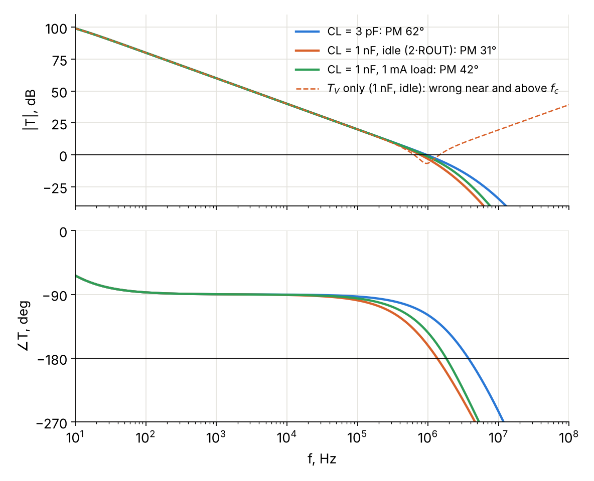

# spice-opamp-macromodels

Parametrized behavioural macromodels of an **operational amplifier** (`OPAMP_FULL`) and a
**fully differential amplifier** (`FDOPAMP_FULL`) for [ngspice](https://ngspice.sourceforge.io/).

Both models are set up directly from datasheet-style parameters (gain, gain-bandwidth, slew
rate, offsets, noise densities, swing, current limits, …) and reproduce the principal
linear, noise and nonlinear effects of a real amplifier. They are meant for circuit-level
work where the ideal op amp is too optimistic and a vendor transistor-level model is
unavailable, too slow or opaque: stability and loop-gain analysis, noise budgets, distortion,
overload and saturation behaviour.



## Contents

| Path | What it is |
|---|---|
| `models/opamp_full.lib` | `OPAMP_FULL` (single-ended op amp) |
| `models/fdopamp_full.lib` | `FDOPAMP_FULL` (fully differential amplifier) and `FDOPAMP_CORE` (the same with the common-mode loop brought out for loop-gain tests) |
| `tests/` | characterization decks that measure every specified quantity and print it |
| `examples/` | five example netlists and `run_examples.py`, which runs them and draws the figures |
| `docs/examples_slides.pdf` | slides with the examples: stability, noise, nonlinear effects |
| `docs/figures/` | figures produced by `run_examples.py` |

## Features

**Linear**
- finite DC gain `A0`, dominant pole set by `GBW`, two non-dominant poles `FP2`, `FP3`
- differential and common-mode input resistance and capacitance (`RID`, `CID`, `RIC`, `CIC`)
- CMRR and PSRR (positive and negative supply) with a 20 dB/decade roll-off above `FCMRR` / `FPSRR`
- output resistance `ROUT` and output capacitance `COUT`
- FDA: an internal common-mode feedback loop with its own DC gain, unity-gain frequency, second pole and slew rate; the `vocm` pin sets the output common-mode voltage and floats to mid-supply when left open

**Noise**
- input voltage noise: white density `ENOISE` plus a 1/f component with corner `FCEN`
- input current noise on each input: white density `INOISE` plus an optional 1/f component with corner `FCIN`; the two inputs have independent noise
- every model-internal resistor is a noiseless controlled source, so the simulated noise is exactly the specified noise (checked to better than 0.1 %)

**Nonlinear**
- input offset voltage, bias and offset currents (`IB > 0` flows into the pins)
- a `tanh()` input transconductor: one mechanism gives both the slew rate `SR` and a realistic growth of distortion as the signal approaches the full-power bandwidth
- input common-mode range with a soft edge (the input stage's gm collapses near the rails)
- optional anti-parallel input clamp diodes (`VCLMP`, `RCLMP`)
- output swing limited by the supplies (`VHD`, `VLD` headroom) with a soft clamp of the gain node, so the output recovers from saturation immediately
- output current limit (`ISRC`, `ISNK`) and a class-AB crossover region (`VXO`) in which the small-signal output resistance doubles
- supply current: quiescent current plus the load current, drawn from the correct rail
- FDA: the differential swing limit follows the headroom around `Vocm`, and both outputs clip symmetrically while the CM loop keeps regulating

### Design choices worth knowing
- `VOS`, the input voltage noise and the CMRR/PSRR error terms form **one error voltage in series with the + input**, ahead of `RID`. No spurious `(VOS + en)/RID` current flows in the source resistance.
- `RIC || CIC` is the common-mode input impedance with both inputs tied together (datasheet convention); each pin gets `2*RIC || CIC/2`.
- The CMRR error is `(Vcm - VCMN)/CMRR`, where `VCMN` (default: mid-supply) is the common-mode voltage at which `VOS` is specified. PSRR is referred to the nominal supplies `VCCN`, `VEEN`.
- In the class-AB crossover (|Iout| below about `VXO/ROUT`) the small-signal output resistance is `2*ROUT`; it is `ROUT` once the output carries more than about `2*VXO/ROUT`. Set `VXO=0` for a constant `ROUT`.
- Noise levels are exact at 27 °C and scale with kT at other temperatures.

## Quick start

```spice
* single-ended op amp, overriding a few parameters
.include models/opamp_full.lib
X1 inp inn vcc vee out OPAMP_FULL PARAMS: GBW=10Meg SR=5Meg ROUT=50

* fully differential amplifier
.include models/fdopamp_full.lib
X2 inp inn vcc vee outp outn vocm FDOPAMP_FULL PARAMS: A0CM=30k
```

Every parameter has a default; pass only those that differ. Units: `SR`, `SRCM` in V/s
(`0.5Meg` = 0.5 V/µs); `CMRR`, `PSRRP`, `PSRRN` as ratios (`31.6k` = 90 dB); `ENOISE` in V/√Hz;
`INOISE` in A/√Hz; frequencies in Hz.

Pins:
- `OPAMP_FULL inp inn vcc vee out`
- `FDOPAMP_FULL inp inn vcc vee outp outn vocm`: `outp` is in phase with `inp`
- `FDOPAMP_CORE inp inn vcc vee outp outn vocm cmo cmi`: as `FDOPAMP_FULL`, with the CM control path brought out (`cmo` = CM error-amplifier output, `cmi` = output-stage CM input). Join `cmo` and `cmi` for normal operation; put a source between them to open the CM loop.

Running the examples:

```sh
cd examples
ngspice 01_opamp_cload_stability.cir      # interactive, with plots
python3 run_examples.py                   # all examples in batch mode, prints results, writes docs/figures
```

`run_examples.py` needs Python 3 with numpy and matplotlib. The test decks are run the same
way, from `tests/`.

## Parameters

| Parameter | Meaning | `OPAMP_FULL` default | `FDOPAMP_FULL` default |
|---|---|---|---|
| `A0` | open-loop DC gain (V/V) | 200k | 100k |
| `GBW` | gain-bandwidth product (Hz) | 1Meg | 100Meg |
| `SR` | slew rate (V/s); differential output slew rate for the FDA | 0.5Meg | 200Meg |
| `FP2`, `FP3` | second and third poles (Hz) | 3Meg, 10Meg | 300Meg, 1G |
| `VOS` | input offset voltage (V) | 1m | 1m |
| `IB`, `IOS` | input bias and offset current (A); `IB > 0` flows into the pins | 80n, 20n | 2u, 0.1u |
| `RID`, `CID` | differential input resistance and capacitance | 2Meg, 1.4p | 1Meg, 1p |
| `RIC`, `CIC` | common-mode input resistance and capacitance (inputs tied) | 200Meg, 1.5p | 100Meg, 2p |
| `CMRR`, `FCMRR` | DC CMRR (ratio) and the frequency where it starts to fall (Hz) | 31.6k, 200 | 31.6k, 100k |
| `PSRRP`, `PSRRN`, `FPSRR` | DC PSRR for the positive and negative supply (ratio), roll-off frequency (Hz) | 31.6k, 31.6k, 100 | 10k, 10k, 100k |
| `VCCN`, `VEEN` | nominal supply voltages (PSRR reference) | 15, −15 | 5, −5 |
| `VCMN` | input CM voltage at which `VOS` is specified | mid-supply | mid-supply |
| `ENOISE`, `FCEN` | white input voltage noise (V/√Hz) and its 1/f corner (Hz) | 20n, 200 | 5n, 1k |
| `INOISE` | white input current noise per input (A/√Hz) | 0.5p | 1p |
| `FCIN` | 1/f corner of the input current noise (Hz); 0 = white only | 0 | 0 |
| `ICCQ` | quiescent supply current (A) | 1.7m | 10m |
| `VHD`, `VLD` | output headroom to the positive / negative rail (V) | 2, 2 | 1.2, 1.2 |
| `ICMHI`, `ICMLO`, `VK` | input CM range headroom to the rails (V) and softness of its edge (V) | 2, 2, 0.15 | 1.5, 1, 0.1 |
| `ROUT`, `COUT` | output resistance and capacitance (per output) | 75, 3p | 10, 1p |
| `ISRC`, `ISNK` | output source / sink current limit (A) | 25m, 25m | 50m, 50m |
| `VXO` | class-AB crossover dead-zone voltage (V); 0 disables it | 2m | 0 |
| `VCLMP`, `RCLMP` | input clamp diode drop at 1 mA (V) and series resistance; `VCLMP=100` disables the clamp | 100, 100 | 100, 100 |
| `A0CM`, `GBWCM`, `FPCM2` | FDA: CM loop DC gain, unity-gain frequency, second pole | — | 10k, 50Meg, 200Meg |
| `SRCM`, `VOSCM` | FDA: output CM slew rate (V/s), CM offset (V) | — | 100Meg, 1m |
| `RVOCM`, `CVOCM` | FDA: `vocm` pin divider (`2*RVOCM` to each rail, noiseless) and capacitance | — | 50k, 1p |

The `OPAMP_FULL` defaults approximate a general-purpose 1 MHz bipolar op amp (µA741
typicals) on ±15 V; the `FDOPAMP_FULL` defaults a generic ±5 V, 100 MHz FDA. A
parameter set for a 5 V CMOS rail-to-rail op amp is given at the end of `opamp_full.lib`.

## Examples

The five examples are described in [docs/examples_slides.pdf](docs/examples_slides.pdf).
Each one shows behaviour that simpler macromodels do not reproduce.

| Example | What it shows | Key result |
|---|---|---|
| `01_opamp_cload_stability.cir` | loop gain of a follower driving a capacitive load, by Middlebrook double injection at the output pin | phase margin 62° (3 pF), 31° with 1 nF at idle, 42° with 1 nF and 1 mA of DC load: the crossover region doubles `ROUT` at idle |
| `02_fda_dm_cm_stability.cir` | DM and CM loop gains of a gain-of-4 FDA with capacitance to ground on each output; the CM loop is opened at the `FDOPAMP_CORE` hook | 220 pF per output: DM 63°, CM only 48°; the faster CM loop loses margin first |
| `03_opamp_noise.cir` | input-referred noise for three source resistances; noise figure vs source resistance | simulated / theory = 1.0000 (1 Hz–10 kHz, sources up to 40 kΩ); NF minimum 3.67 dB at `ENOISE/INOISE` = 40 kΩ |
| `04_opamp_large_signal.cir` | slew rate, THD vs frequency, clipping and recovery, current limit and supply current | slew 0.50 V/µs; THD 0.001 % at 2 kHz, 0.5 % at `SR/(2πVp)` = 8 kHz, 6.6 % at 10 kHz; clipping at ±12.44 V into 2 kΩ; 25 mA limit, supply current 26.7 mA |
| `05_fda_swing_vocm.cir` | FDA differential swing for two output CM voltages | ±7.41 V at `Vocm` = 0, ±4.49 V at `Vocm` = 1.5 V; output CM held within 1 mV while clipping |

The loop-gain examples combine two AC runs (series voltage injection, shunt current injection)
inside the ngspice control block, so one run of the netlist gives the final loop gain T and the
phase margin.

## Verification

The decks in `tests/` measure the model against its parameters with `meas` statements. With
ngspice-42 and the default parameters:

| `OPAMP_FULL` | Result | `FDOPAMP_FULL` | Result |
|---|---|---|---|
| A0, fu, PM | 106.0 dB, 956 kHz, 71° | A0, fu, PM | 100.0 dB, 95 MHz, 67° |
| CMRR, PSRR± at DC | 90 dB | CMRR at DC / 1 MHz | 90 dB / 70 dB |
| CMRR at 1 kHz | 75.8 dB | PSRR+ at DC | 80 dB |
| slew rate (10–90 %) | 0.48 V/µs | slew DM / CM (10–90 %) | 151 / 83 V/µs |
| settling to 1 mV (±5 V step) | 21.3 µs | gain-4 stage, −3 dB | 25.6 MHz |
| swing into 2 kΩ | ±12.44 V | differential swing into 1 kΩ | ±7.41 V |
| current limit | ±25.0 mA | current limit | ±49.7 mA |
| supply current | 1.71 mA | DM / CM loop gain, gain-4 stage | 19.3 MHz, 77° / 48.5 MHz, 76° |
| noise vs theory | within 0.02 % | output noise vs theory | within 0.1 % |
| 1/f current noise (`FCIN` = 2k) | within 0.03 % | 1/f current noise (`FCIN` = 10k) | within 0.01 % |

`tests/fd_middlebrook.cir` also checks the Middlebrook loop gains of the FDA against a
conventional L/C loop break (CM: identical; DM: within 0.5 %, the residual being the loading
error of the L/C reference).

## Compatibility

Developed and tested with **ngspice-42**. The models use B-sources (`tanh`, `min`, `max`,
`sqrt`), subcircuit parameters with `PARAMS:` and the diode `KF`/`AF` flicker-noise
parameters. `OPAMP_FULL` has also been used through the ngspice back end of the KiCad 9
simulator. Other SPICE dialects (LTspice, Xyce, PSpice) have not been tested.

## Acknowledgements

The models, test decks, examples and documentation were developed with the help of
**Claude Opus 5.5** (Anthropic).

## License

BSD 2-Clause License. Copyright © 2026 Stanislav Maslovski. See [LICENSE](LICENSE).
