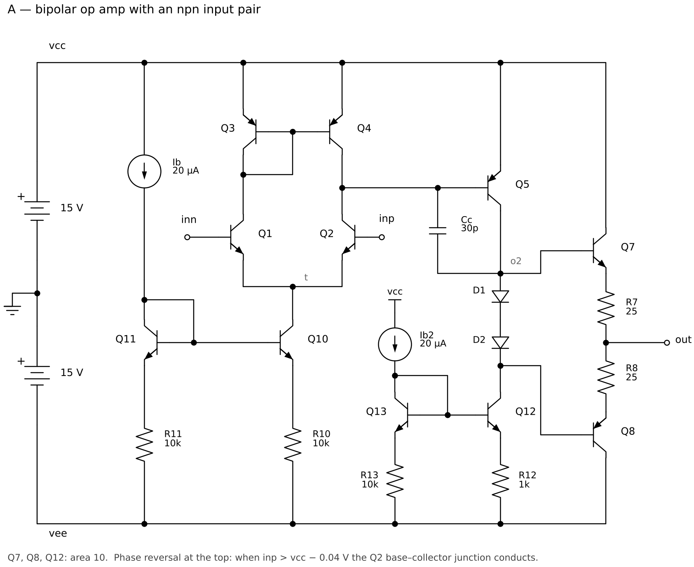
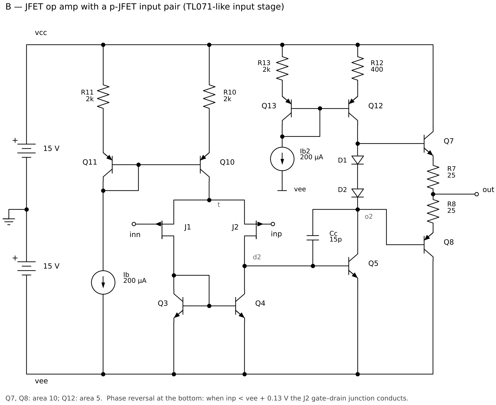
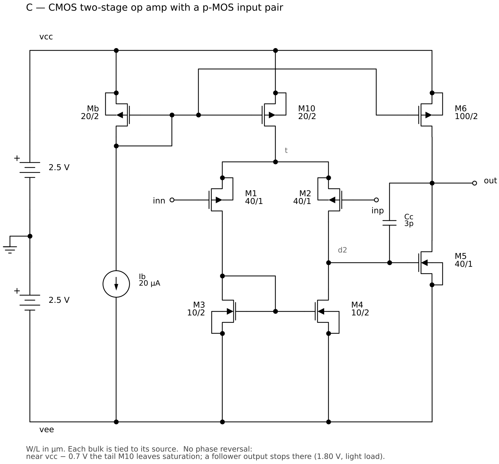
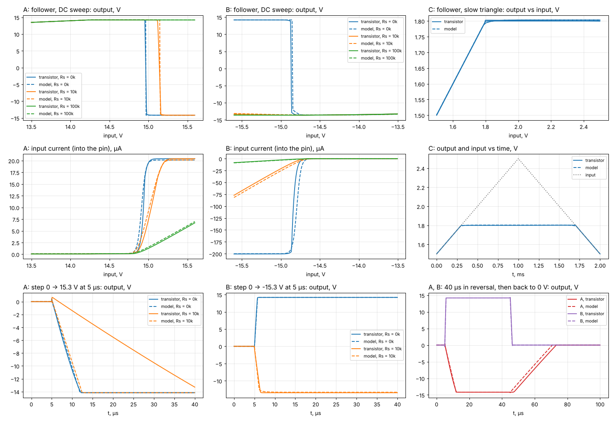

# Phase reversal: transistor-level references for OPAMP_FULL

This folder holds three minimal transistor-level op amps. They show what happens
when an input is driven beyond the common-mode range, and they check how well
`OPAMP_FULL` reproduces it. The circuits use generic, self-written device models
with round-number parameters. They do not model any real part, but their input
stages are the three common types:

| | Input pair | Supply | Reverses |
|---|---|---|---|
| **A** (`opa_npn.lib`) | npn bipolar, pnp current-mirror load | ±15 V | at the top only |
| **B** (`opa_pjfet.lib`) | p-channel JFET, npn current-mirror load (TL071-like) | ±15 V | at the bottom only |
| **C** (`opa_pmos.lib`) | p-channel MOSFET, n-MOS current-mirror load | ±2.5 V | never; the output stops at the edge |

## Contents

| File | What it is |
|---|---|
| `devices.lib` | generic BJT, JFET, MOSFET and diode models |
| `opa_npn.lib`, `opa_pjfet.lib`, `opa_pmos.lib` | the three op amps, pins `inp inn vcc vee out` |
| `schematics/` | schematics (PNG, SVG) and the scripts that draw them (needs [schemdraw](https://schemdraw.readthedocs.io)) |
| `characterize.py` | measures each op amp as a datasheet would. The macromodel parameters below come from these numbers |
| `compare_reversal.py` | drives the references and `OPAMP_FULL`, with fitted parameters, beyond the input range. Prints a comparison and writes `reversal_compare.png` |
| `reversal_compare.png` | the figure written by `compare_reversal.py` |

Both scripts need ngspice, Python 3, numpy and matplotlib:

```
cd tests/transistor_level
python3 characterize.py
python3 compare_reversal.py
```

The decks and raw data are written to `out/`.

## The three circuits

All three are two-stage op amps: a differential pair with a current-mirror load, a
second gain stage with Miller compensation, and (A, B) a class-AB emitter-follower
output. In all three, `inn` drives the left transistor of the pair and `inp` the right one.
In A and B the current-source load of the second stage (Q12) has its own bias (Ib2, Q13,
R13). When the output is driven into a rail, Q12 saturates and its base current rises;
on a bias line shared with the tail mirror it would take most of the reference current
and collapse the tail current of the input pair. Whether this happens in a real op amp
depends on its bias network, so the reference circuits leave it out.







Characterization by `characterize.py`:
- **Load:** 10 kΩ for A and B, 100 kΩ for C, whose output stage sources only about 100 µA.
- **Slew rate:** a follower stepped by half the supply span each way.
- **Swing:** open loop, overdriven by ±0.1 V.
- **Linear range:** where the output of a follower driven by a slow triangle stays within 10 mV of its input.

| | A0, dB | f_u, MHz | PM, ° | SR+ / SR−, V/µs | V_o max / min, V | I_q, mA | I_B, nA | follower linear range, V | follower reverses at |
|---|---|---|---|---|---|---|---|---|---|
| A | 74.7 | 1.67 | 65 | 0.54 / 0.66 | 14.22 / −14.17 | 1.15 | 49.4 | −14.18 … +14.11 | +14.99 V |
| B | 78.8 | 4.78 | 83 | 11.9 / 11.9 | 14.18 / −14.17 | 3.37 | 0.015 | −12.81 … +14.19 | −14.88 V |
| C | 89.9 | 9.75 | 77 | 6.45 / 6.82 | 2.46 / −2.49 | 0.14 | 0 | −2.29 … +1.81 | no reversal |

The "reverses at" column is where the output of the slowly driven follower crosses
zero against the input. The DC sweeps below give the threshold without the slewing
delay.

## What happens beyond the input range

All results are for unity-gain followers.

1. **Reversal comes from a junction of the input pair that becomes forward biased.**
   - **A, at the top only.** The collector of Q2 sits one V_BE below vcc. Once `inp`
     comes within about 40 mV of vcc, the Q2 base-collector junction conducts. Its
     current flows from the input pin straight into the high-impedance node of the
     first stage, against the normal signal. Q2 saturates and no longer amplifies.
     The output runs to the negative rail.
   - **B, at the bottom only.** The drain of J2 sits one V_BE above vee. Once `inp`
     comes within about 0.13 V of vee, the J2 gate-drain junction conducts, with the
     same result in the other direction.
   - **C never reverses.** A MOS gate has no junction to the channel.
   - Each circuit reverses at one end of the range only. At the other end the
     output simply stops.
   - There is no hysteresis: sweeping up and down gives the same threshold.
2. **The input pin carries the whole tail current during reversal.** The
   saturated input device passes the tail current through its forward-biased
   junction into the pin: +20.4 µA in A (into the pin, tail 20 µA), −200 µA in B
   (out of the pin, tail 200 µA). It stays at that value for any larger overdrive.
3. **The source resistance decides whether the output reverses.**
   - The junction needs a current of about the tail current to take over the first
     stage. A source resistance R_S limits that current to roughly
     (overdrive)/R_S.
   - With 10 kΩ, A still reverses (at +15.14 V instead of +14.97 V) but B does not.
   - With 100 kΩ, neither reverses up to 0.6 V beyond the rail.
   - This is why datasheets recommend a series resistor at the input of op amps
     that show reversal.
4. **Entering reversal is faster than the slew rate.** The junction current goes
   straight into the compensation node, so the output moves at 2.1 V/µs in A
   (SR 0.6 V/µs) and 20 V/µs in B (SR 11.9 V/µs). A source resistance slows this
   down (A with 10 kΩ: 0.40 V/µs).
5. **Leaving reversal includes a saturation delay.** When the input returns to 0 V
   after 40 µs in reversal, the output of A starts to move only after 4.8 µs; the
   saturated transistors must first discharge. B returns after 0.23 µs. Both then
   move at the slew rate.
6. **In C, the tail current source ends the range.**
   - Once `inp` approaches vcc − 0.7 V, the tail transistor M10 leaves saturation.
     The tail current, and with it the gain, collapses.
   - A slowly driven follower's output stops at 1.80 V and stays there for any
     higher input, then follows again when the input comes back.
   - In a DC sweep the gate of M5 (node d2) is undefined once no tail current
     flows, and the simulator may return a solution with the output at the rail.
     Use a transient for this circuit.
   - With a 10 kΩ load the output stops at 1.01 V instead. That limit is the output
     stage's ~100 µA source current, not the input range.

## How OPAMP_FULL models it

Since version 1.5, phase reversal is modelled as current through an input junction:

| Parameter | Meaning |
|---|---|
| `PRHI`, `PRLO` | Reversal at the top (e.g., npn inputs) or at the bottom (e.g., p-JFET inputs); 0 = no junction. The value is the speed at which the output enters reversal, in units of the slew rate. |
| `VPRHI`, `VPRLO` | Input voltage below `vcc` / above `vee` at which the output flips (negative = beyond the rail) |
| `IPR` | Input current of the conducting junction, about the tail current of the input pair. 0 = SR × 30 pF. |

How it works:
- The conduction J (0…1) of each junction is a step of thermal-voltage width
  centred at the threshold.
- The pin carries `IPR`·J: into the pin at the top, out of it at the bottom.
- The input stage's gain is scaled by (1 − J).
- A current of up to `PRHI`·I_max is injected into the gain node, so the output
  enters reversal at about `PRHI` × the slew rate.
- The injection is shaped so that the output flips at J = ½ for any `PRHI` ≥ 1.
  There the input current is 0.9·`IPR`.
- A source resistance R_S therefore prevents reversal while 0.9·R_S·`IPR` is larger
  than the overdrive.
- The input-range window (`ICMHI`, `ICMLO`, `VK`) is separate, so it can end the
  linear range before the junction conducts, as in B.
- Each edge of the window is judged by the input that matters there: the lower
  input at the top, the higher one at the bottom. A follower driven beyond the range
  therefore stops at the edge, as C does.

### Fitted parameters

`compare_reversal.py` uses these instance parameters. A0, GBW, FP2/FP3, SRR/SRF,
VHD/VLD and IB come from the characterization table:
- GBW = f_u divided by the phase-margin factor (f_u/GBW), and FP2 from the phase
  margin, both tabulated in `skills/datasheet-to-params/SKILL.md`; FP3 = 3.33·FP2.
- CMRR and PSRR are kept flat (`FCMRR` = `FPSRR` = 1G), since their roll-off was not
  characterized. (A fixed `FCMRR` of 200 Hz with C's 10 MHz GBW would leave the CMRR
  below 0 dB at the unity-gain frequency, and the error it adds in a follower would
  make the step response ring; the defaults now scale with `GBW` to avoid this.)
- VHD and VLD are the headroom from the swing, corrected for the default `ROUT`.
- `RID` = 2V_T/I_B for the bipolar pair.

The remaining parameters were fitted:
- `ICMHI`, `ICMLO`, `VK`: to the follower's linear range.
- `PRHI`/`PRLO`, `VPRHI`/`VPRLO`, `IPR`: to the R_S = 0 DC sweep and the step response.

```
A: A0=5.4k GBW=1.78Meg FP2=4.8Meg FP3=16Meg SRR=0.54Meg SRF=0.66Meg VHD=0.67 VLD=0.72
   ICMHI=0.1 ICMLO=1.5 IB=49n IOS=0 RID=1.05Meg FCMRR=1G FPSRR=1G PRHI=3.5 VPRHI=0.03 IPR=20u
B: A0=8.7k GBW=4.83Meg FP2=35Meg FP3=118Meg SRR=11.9Meg SRF=11.9Meg VHD=0.71 VLD=0.72
   ICMHI=1 ICMLO=2.8 VK=0.5 IB=15p IOS=0 RID=1T RIC=1T FCMRR=1G FPSRR=1G PRLO=1.6 VPRLO=0.15 IPR=200u
C: VCCN=2.5 VEEN=-2.5 A0=31k GBW=9.9Meg FP2=57Meg FP3=189Meg SRR=6.45Meg SRF=6.82Meg VHD=0.04
   VLD=0.01 VXO=0 ICMHI=0.734 ICMLO=-0.1 VK=0.01 IB=0 IOS=0 RID=1T RIC=1T FCMRR=1G FPSRR=1G
```

Notes on the fit:
- The fitted `IPR` equals the tail current of the input pair in both A and B.
- B loses gain gradually from about −12.8 V, long before its junction conducts at
  −14.87 V. A wide window edge (`ICMLO`=2.8, `VK`=0.5) reproduces the follower's
  output within 59 mV RMS over that region.
- `VK` sets how sharp the edge of the input range is. C's tail transistor leaves
  saturation abruptly, and `VK` = 0.01 reproduces its sharp knee: the follower error
  grows from 10 mV to the full stop within about 10 mV of input. With the default
  0.05 the knee is rounded over about 0.1 V.
- A follower stops slightly beyond the half-gain point given by `ICMHI`, because its
  loop gain is still high there: for C (A0 = 31k, `VK` = 0.01) by 0.04 V, hence
  `ICMHI` = 0.734 for a stop at vcc − 0.70 V.

### Comparison

Output of `compare_reversal.py`:

| | Transistor level | OPAMP_FULL |
|---|---|---|
| A, flip at R_S = 0 / 10 kΩ / 100 kΩ | +14.965 V / +15.140 V / none | +14.965 V / +15.145 V / none |
| A, input current in reversal (R_S = 0) | 20.4 µA | 20.1 µA |
| A, output speed entering reversal, R_S = 0 / 10 kΩ | 2.09 / 0.40 V/µs | 2.07 / 1.95 V/µs |
| A, delay before leaving reversal | 4.8 µs | 2.6 µs |
| B, flip at R_S = 0 / 10 kΩ / 100 kΩ | −14.870 V / none / none | −14.855 V / none / none |
| B, input current in reversal (R_S = 0) | −200.5 µA | −200.0 µA |
| B, output speed entering reversal (R_S = 0) | 19.9 V/µs | 18.9 V/µs |
| B, delay before leaving reversal | 0.23 µs | 0.14 µs |
| C, follower driven to vcc: output stops at | 1.803 V, no reversal | 1.803 V, no reversal |



What the model reproduces:
- the side on which reversal occurs and its threshold (within 15 mV);
- whether a given source resistance prevents reversal, and where it occurs if it
  does not;
- the input current, before, at and after the flip;
- the faster-than-slew-rate entry from a low-impedance source;
- the output stopping at the edge when there is no junction.

What it does not reproduce:
- With a source resistance the real entry into reversal slows down more than the
  model's (A with 10 kΩ).
- The model has no saturation delay when leaving reversal. In A the real delay is
  4.8 µs; the model only needs to slew the first 10 %.

## Choosing the parameters from a datasheet

- **Which side.** Set `PRHI` or `PRLO` only if the datasheet says the output
  reverses. Use the side it names: typically the top for npn inputs and the bottom
  for p-JFET inputs. CMOS inputs normally do not reverse. A value of 2 is a
  reasonable default; the references give 1.6 and 3.5.
- **Threshold.** `VPRHI` / `VPRLO` is the distance from the rail at which the
  datasheet says reversal begins. If it says only "beyond the common-mode range",
  use the headroom at the end of the specified range.
- **Junction current.** Leave `IPR` at 0 (SR × 30 pF, roughly the tail current of a
  general-purpose op amp) unless the datasheet gives more. If it says a series
  resistor R prevents reversal for an overdrive V_od, use `IPR` = V_od / (0.9·R).
